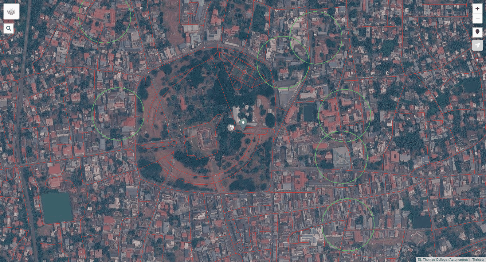
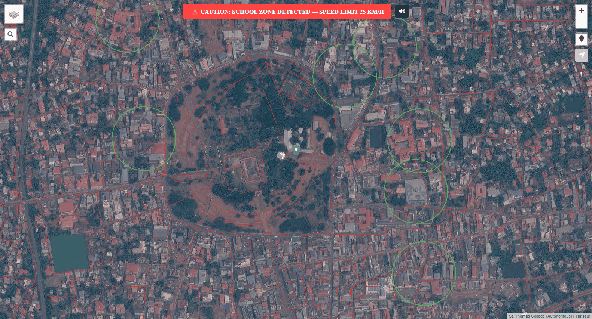
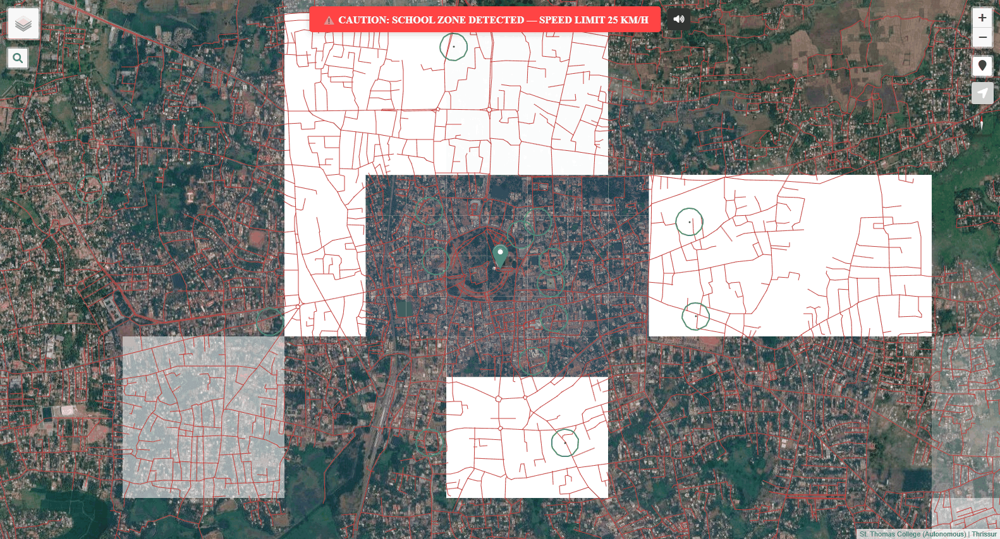

# School_Zone_Alert_System

<p align="center">
  
  
  
  
  
</p>

An interactive Web GIS School Zone Alert & Speed Warning System. Visualizes school locations, corporate road networks, and buffer safety zones with real-time GPS proximity alarms to promote road safety in pedestrian-dense areas.

---

## 📸 Hero Preview

<p align="center">
  
</p>

## 🖼️ UI Snapshot Gallery

<p align="center">
  
  
</p>

---

## ✨ Features

- 🗺️ **Interactive Web GIS Platform** - High-performance geospatial visualization powered by Leaflet and QGIS-exported vector datasets.
- ⚠️ **Dynamic Proximity Warnings** - Automated visual caution banner and alert triggers when entering school perimeter buffers.
- 🛡️ **Safety Buffer Perimeters** - Spatial polygon buffer rings mapping danger areas and recommended 25 km/h speed limits.
- 🔍 **Integrated Facility Search** - Fast search bar with automatic fly-to animation for schools and institutions.
- 📍 **Live Geolocation Tracking** - Real-time device GPS positioning (`L.Control.Locate`) to calculate live vehicle proximity.
- 🌲 **Layer Tree & Compass Controls** - Toggle road networks, school points, and buffers individually with integrated orientation compass.

---

## 🛠️ Tech Stack

- **Mapping & GIS**: Leaflet.js, QGIS2Web, Leaflet-Search, Leaflet-Locate
- **Geospatial Data**: GeoJSON Vector Datasets (Roads, Institutions, Safety Buffers)
- **Frontend**: HTML5, Modern CSS, FontAwesome

---

## 🚀 Quick Start

### 1. Clone the repository
```bash
git clone https://github.com/soorajstudio/School_Zone_Alert_System.git
cd School_Zone_Alert_System
```

### 2. Run locally
```bash
cd project_final_FINAL

# Using Python
python -m http.server 8080

# Or using Node
npx serve .
```

Open [http://localhost:8080](http://localhost:8080) in your browser.

---

## 📄 License

This project is licensed under the MIT License — see the [LICENSE](LICENSE) file for details.

Developed with ❤️ by [Sooraj Studio](https://github.com/soorajstudio).
